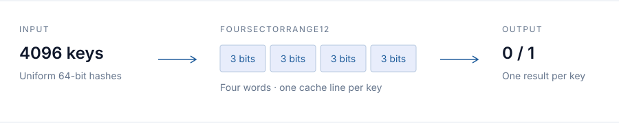

# Fastest Bloom Filter

### High-throughput membership queries. Native C++ and Rust.

Bloom filters for processing keys in batches: compact cache-line layouts, SIMD queries, and parallel construction. Start with **FourSectorRange12** for a 24-bit/key budget and a measured false-positive target of **0.01%**. Choose a layout using the memory and error limits of your workload.

[External libraries](#compared-libraries) · [Query performance](#query-performance) · [Get started](#get-started) · [Design and API](docs/api.md) · [Reproduce](docs/reproduce.md)



## Compared libraries

We benchmark against **Boost.Bloom 1.92.0**, **RocksDB v11.12**, **FastFilter**, and **PageBloomFilter** in C++; and **fastbloom 0.17.0**, **fastbloom-rs 0.5.10**, **Bloomsday**, and **sbbf-rs-safe 0.3.2** in Rust. The tables below identify these libraries directly. [Pinned revisions, adapter contracts, and exact configurations →](docs/external-baselines.md)

RocksDB results measure its Bloom filter core and batch schedule, not database reads. Boost uses its public bulk-query API. The Rust panel calls public membership APIs with their required hashing. Memory and calibrated FPR limits apply before speed is ranked.

## Query performance

**4096 keys per batch. Nanoseconds per key. Lower is faster.**

Measured on an Intel Xeon Platinum 8474C with AVX-512 enabled: 65,536 or 33,554,432 inserted keys, 50% query hits, and 4,194,304 queries per timed pass. The next three tables use an **actual allocation ceiling of 24 bits/key** and a **0.01% FPR quality gate**. Native filter sizes are 192 KiB and 96 MiB respectively.

### C++ · one core

Prehashed queries and common-hash-plus-query are separately timed contracts. Each value is the geometric mean of three construction-seed medians, with six timing trials per seed. The table shows **all five APIs** in the fixed confirmation panel, including FastFilter, Boost.Bloom and RocksDB. Every API passes the quality gate at both sizes.

<!-- BEGIN CPP_RESULTS -->
| Inserted keys | Method | Prehashed ns/key | Hash + query ns/key |
| ---: | :--- | ---: | ---: |
| 65,536 | FourSectorRange12 (ours) | 1.1949 | 1.7066 |
| 65,536 | Split64Range (ours) | 1.6933 | 2.2606 |
| 65,536 | FastFilter · Fixed64 | 2.1806 | 2.7308 |
| 65,536 | Boost.Bloom · Multi64, k=8 | 2.2293 | 2.9613 |
| 65,536 | RocksDB · FastLocalBloom64, k=8, batch32 | 2.7132 | 3.2238 |
| 33,554,432 | FourSectorRange12 (ours) | 5.6188 | 5.2459 |
| 33,554,432 | Split64Range (ours) | 6.0818 | 5.4755 |
| 33,554,432 | Boost.Bloom · Multi64, k=8 | 6.5089 | 5.8004 |
| 33,554,432 | RocksDB · FastLocalBloom64, k=8, batch32 | 8.2283 | 7.9045 |
| 33,554,432 | FastFilter · Fixed64 | 8.7466 | 8.6175 |
<!-- END CPP_RESULTS -->

### Rust · one core

Raw-key queries include each API's required hashing. Eight timing trials, one previously seen construction seed. The table includes both native layouts and the fastest qualifying measured configuration from each external library admitted under this strict condition. Bloomsday and sbbf have no qualifying measured configuration here; their 1% results appear below. These measurements use a separate Rust harness; they are not a C++ versus Rust language comparison.

<!-- BEGIN RUST_RESULTS -->
| Inserted keys | Method | Raw query ns/key |
| ---: | :--- | ---: |
| 65,536 | FourSectorRange12 (ours) | 1.6447 |
| 65,536 | Split64Range (ours) | 2.1370 |
| 65,536 | fastbloom 0.17.0 · k=7 | 11.7867 |
| 65,536 | fastbloom-rs 0.5.10 · k=7 | 26.3409 |
| 33,554,432 | Split64Range (ours) | 5.4348 |
| 33,554,432 | FourSectorRange12 (ours) | 5.4837 |
| 33,554,432 | fastbloom 0.17.0 · k=7 | 33.3091 |
| 33,554,432 | fastbloom-rs 0.5.10 · k=7 | 54.9355 |
<!-- END RUST_RESULTS -->

### C++ · eight physical cores

A common executor splits the query stream across eight cores and calls each API in batches of 4096. **Thread creation and join are included.** Values are elapsed wall time divided by the total keys, not individual request latency. Three construction-seed medians, six timing trials per seed. This is a shared-executor comparison, separate from timings of the native parallel wrappers.

<!-- BEGIN MT_RESULTS -->
| Inserted keys | Method | Prehashed ns/key | Hash + query ns/key |
| ---: | :--- | ---: | ---: |
| 65,536 | FourSectorRange12 (ours) | 0.2048 | 0.2780 |
| 65,536 | Split64Range (ours) | 0.2690 | 0.3392 |
| 65,536 | FastFilter · Fixed64 | 0.3299 | 0.4025 |
| 33,554,432 | FourSectorRange12 (ours) | 0.7953 | 0.7529 |
| 33,554,432 | Split64Range (ours) | 0.8531 | 0.7792 |
| 33,554,432 | Boost.Bloom · Multi64, k=8 | 0.8969 | 0.8228 |
<!-- END MT_RESULTS -->

### Broader comparison · one core · 16 bits/key · 1% FPR

Each row uses that library's **fastest qualifying measured configuration** at each size, with an actual allocation ceiling of 16 bits/key. This includes libraries that cannot meet the stricter 0.01% condition above. All entries use **batch4096**, include hashing, and report **ns/key**. The native row also selects its fastest qualifying layout; it is not a FourSectorRange12 result.

**C++ · common hash + query.** One seen seed, six trials (`CPP988`).

<!-- BEGIN CPP_LIBRARIES -->
| Library | 65,536 keys · ns/key | 33,554,432 keys · ns/key |
| :--- | ---: | ---: |
| Our best measured layout | 1.2137 | 4.0411 |
| Boost.Bloom 1.92.0 | 2.1938 | 4.1937 |
| RocksDB v11.12 | 2.8761 | 5.5560 |
| FastFilter | 1.6069 | 4.5468 |
| PageBloomFilter | 7.3062 | 16.0819 |
<!-- END CPP_LIBRARIES -->

**Rust · raw-key query.** One seen seed, eight trials (`Rust786`).

<!-- BEGIN RUST_LIBRARIES -->
| Library | 65,536 keys · ns/key | 33,554,432 keys · ns/key |
| :--- | ---: | ---: |
| Our best measured layout | 1.0868 | 4.2319 |
| fastbloom 0.17.0 | 9.4548 | 16.5559 |
| fastbloom-rs 0.5.10 | 18.9280 | 31.8312 |
| Bloomsday | 1.9035 | 5.4982 |
| sbbf-rs-safe 0.3.2 | 2.7863 | 6.9245 |
<!-- END RUST_LIBRARIES -->

These are within-panel comparisons. [Exact selected methods and actual bytes](docs/external-baselines.md#configurations-behind-the-readme-library-tables) are retained for every cell; all qualifying alternatives remain in the downloadable data.

FourSectorRange12 leads this C++ strict-budget panel. In the Rust large-table result, Split64Range is slightly faster. At looser error targets, FastPattern, FourSector, and Split64 can be better choices. The [complete performance report](docs/performance.md) includes the top three for every published condition, actual allocations, and all 1,170 qualifying configuration rows.

These are measurements of selected implementations on this machine. Quality gates use finite-sample, pointwise Wilson upper bounds; they are not guarantees for every dataset. Small timing differences are descriptive. Results do not establish universal leadership or an end-to-end SQL speedup.

## Get started

### C++

Use the headers in `include/` with C++17. Hash keys uniformly to 64 bits before insertion and lookup. This example uses a literal 24-bit/key budget for 65,536 keys.

```cpp
#include "four_sector_range12_bloom.h"
#include <array>
#include <cassert>
#include <vector>

int main() {
    constexpr size_t n = 65536;
    bloom_filters::FourSectorRange12BloomFilter filter(
        bloom_filters::RangeBytes{n * 3});
    std::vector<uint64_t> hashes(n);
    for (size_t i = 0; i < n; ++i)
        hashes[i] = bloom_filters::MurmurHash64(i);
    filter.Insert(n, hashes.data());

    std::array<uint32_t, 4096> answers{};
    filter.Lookup(answers.size(), hashes.data(), answers.data());
    for (auto answer : answers) assert(answer == 1);
}
```

```sh
c++ -std=c++17 -O3 -march=native -Iinclude example.cpp -o example
```

`-march=native` targets the build machine. Compile for the deployment ISA when distributing binaries. Standalone headers include scalar paths; the benchmark suite defaults to AVX2.

### Rust

Add this repository's `rust/` directory as a local dependency. Rust 1.89 or newer is required; the library has no external crate dependencies.

```toml
[dependencies]
fastest-bloom-filter = { path = "../Fastest-Bloom-Filter/rust" }
```

```rust
use fastest_bloom_filter::{hash64, FourSectorRange12BloomFilter};

fn main() {
    let hashes: Vec<u64> = (0..65_536_u64).map(hash64).collect();
    let mut filter = FourSectorRange12BloomFilter::with_byte_budget(hashes.len() * 3)
        .expect("valid byte budget");
    filter.insert_hashes(&hashes);

    let mut answers = vec![0_u32; 4096];
    filter.lookup_hashes(&hashes[..4096], &mut answers);
    assert!(answers.iter().all(|&answer| answer == 1));
}
```

Rust selects AVX-512, AVX2, or scalar queries at runtime. The `disable-avx512` feature retains AVX2 and scalar dispatch.

## Parallel construction and queries

C++ provides `ParallelFourSectorRange12BloomFilter` in `parallel_four_sector_range12_bloom.h`, with `InsertParallel(count, hashes, workers)` and `LookupParallel(count, hashes, answers, workers)`.

Rust exposes `insert_hashes_parallel(&hashes, workers)` and `lookup_hashes_parallel(&hashes, &mut answers, workers)` directly on the filter. Both languages assign complete physical cache lines to construction workers, then allow concurrent immutable queries. Construction requires exclusive access. [Memory accounting and concurrency contracts →](docs/api.md)

## Design

FourSectorRange12 probes four 32-bit words in one 64-byte cache line, setting three bits per word. A small pattern dictionary generates masks; batch kernels process independent keys with SIMD. Range reduction supports byte budgets that are not powers of two. Keeping the probes local and exposing independent work across a batch are central to this design.

| Layout | A useful starting point |
| :--- | :--- |
| **FourSectorRange12** | Strict 0.01% target at 24 actual bits/key; bulk queries |
| **Split64Range** | Exact byte budgets; competitive large-table Rust queries |
| **FastPattern** | Throughput at a looser 1% target |
| **FourSector** | A 0.1% target with a compact cache-line layout |
| **Split64** | Large-table queries at a 0.1% target |
| **ByteSplit** | A byte-oriented SIMD alternative with FastFilter-derived masks |

These are starting points from the published workload, not guaranteed FPR settings. Check actual bytes and calibrate the error rate on your data. Each layout is available natively in C++ and Rust; legacy C++ baselines remain available for comparison.

## Build and check

```sh
cmake -S . -B build/native -DCMAKE_BUILD_TYPE=Release -DBF_NATIVE=ON
cmake --build build/native -j
ctest --test-dir build/native --output-on-failure
cargo test --locked --manifest-path rust/Cargo.toml
cargo test --locked --manifest-path rust/Cargo.toml --features disable-avx512
```

See [reproduction instructions](docs/reproduce.md) for batch4096 runs, frozen external comparisons, and regenerating the published tables. [Release validation](docs/release-validation.md) records the checks for this source package.

## License and attribution

Project code is [MIT licensed](LICENSE). ByteSplit includes adaptations of FastFilter code under [Apache-2.0](third_party/FastFilter/LICENSE); retain its [notice](third_party/FastFilter/NOTICE). The Rust package includes both licenses and its own [attribution](rust/NOTICE). External baselines in the research archive retain their upstream licenses.
