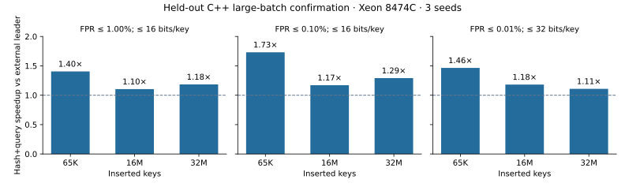
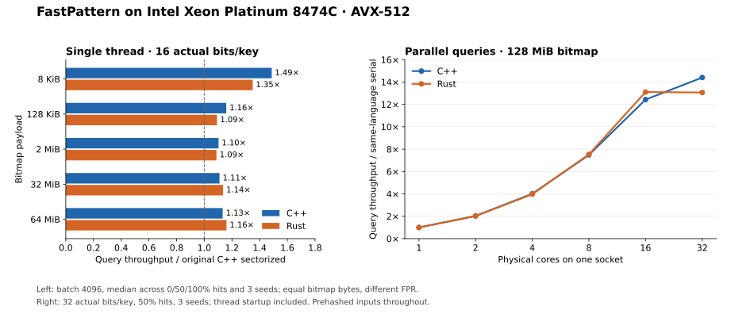

# Fastest Bloom Filter

Native **C++17 and Rust** Bloom filters with **AVX-512 / AVX2**, parallel construction,
parallel membership queries, and an atomic FastPattern type for concurrent readers/writers.
Four native layouts cover different throughput/accuracy tradeoffs: **FastPattern**,
**FourSector**, **Split64**, and **ByteSplit**. Each keeps a key's probes within one cache line.
The aim is to improve throughput while making the memory and false-positive tradeoffs visible.
The project name is an ambition, not a claim that one implementation wins every workload.

## Modern external comparison

The initial screen compared **43 C++ configurations in one shuffled process**:
FastPattern, pinned FastFilter SIMD/classical variants, PageBloomFilter, and
Boost.Bloom 1.92 with its native bulk APIs. The current executable adds native
FourSector/Split64/ByteSplit, eight RocksDB FastLocalBloom core configurations,
and two FastFilter single-call controls, for **56**.
A separate native Rust suite includes
pinned Bloomsday and fastbloom. See the [survey](docs/external-survey-2026-10-28.md)
and [shared-harness instructions](benchmarks/all-external/README.md).

Ranking constrains **measured filter payload allocation and observed FPR**, distinguishing
prehashed kernels from raw-key end-to-end work. Build batches are independently
configurable, temporary build allocations are reported, and timed construction
holds only one bitmap at a time. Screening uses explicit error ceilings and a
pointwise 95% Wilson bound; final candidates need held-out confirmation.
The completed large-batch confirmation has **234 C++ rows and 90 Rust rows**,
using three new insertion seeds and 50 million independent calibration negatives
per configuration. In the C++ shortlist, our eligible query leaders are
**1.10–1.73× faster** than the fastest eligible external configuration across the
reported memory/FPR ceilings. This covers 65K–32M keys, 50% hits, batch 4096,
and allocations up to 128 MiB on one Xeon Platinum 8474C core.



| At 16M keys | Memory ceiling | Our query leader | Hash+query | Best eligible external |
| --- | --- | --- | --- | --- |
| FPR ≤ 1% | 16 bits/key | FastPattern | 3.709 ns/key | FastFilter SIMD: 4.096 ns/key |
| FPR ≤ 0.1% | 16 bits/key | Split64 | 3.789 ns/key | Boost Multi64K8: 4.433 ns/key |
| FPR ≤ 0.01% | 32 bits/key | FastPattern | 4.110 ns/key | FastFilter Fixed32: 4.855 ns/key |

Eligibility uses a pointwise 95% FPR upper bound; exact allocations remain visible.
This is a query result within the stated contract. FourSector still has construction
and short-batch losses. In the separate [47-configuration single-key screen](docs/single-screen-2026-10-28.md),
FastFilter wins the shown 1% and 0.01% bands; Split64 wins 0.1% at 16 bits/key.
That screen is exploratory and single-key optimization continues. The wider
mask dictionary in the report remains experimental. See the
[complete confirmation, including Rust and build timings](docs/modern-confirmation-2026-10-28.md),
[screening results](docs/modern-screen-2026-10-28.md), and
[frozen protocol](docs/confirmation-protocol-2026-10-28.md).

A newer [240-row RocksDB-inclusive screen](docs/rocksdb-screen-2026-10-29.md)
retains large-batch leads while exposing remaining single-key and short-batch
losses. The completed [native single-key confirmation](docs/byte-confirmation-2026-10-29.md)
adds **276 C++ / 96 Rust rows** with three held-out seeds and stronger FastFilter
single-call controls. C++ ByteSplit's small-filter prehashed query is **7–8% faster**,
but its hash+query advantage shrinks to **0.5–0.9%**. Split64 leads the C++ 0.1% FPR
band by **1.10–1.20×** in hash+query; FastFilter still wins the strict 0.01% band
and the large-filter 1% band in that metric. Rust also retains small-filter losses
against Bloomsday. These results supersede the prototype's roughly 8% end-to-end
gain as evidence for the native port; optimization continues from the losses.

## Native layouts

| Layout | C++ header/type | Rust type | Observed FPR at 16 actual bits/key |
| --- | --- | --- | --- |
| FastPattern | `fast_pattern_BF.h` / `FastPatternBF` | `FastPatternBloomFilter` | About 0.20% |
| FourSector | `four_sector_bloom.h` / `FourSectorBloomFilter` | `FourSectorBloomFilter` | About 0.098% |
| Split64 | `split64_bloom.h` / `Split64BloomFilter` | `Split64BloomFilter` | About 0.091% |
| ByteSplit | `byte_split_bloom.h` / `ByteSplitBloomFilter` | `ByteSplitBloomFilter` | About 0.55% |

These FPRs are measured on uniform hashes, not hard guarantees for arbitrary inputs.
FourSector sets two bits in each of four 32-bit sectors; Split64 sets one in each
of eight 64-bit sectors. Both have native scalar, AVX2 and AVX-512 query paths,
with matching C++/Rust bitmaps, exclusive parallel construction and parallel reads.
Rust detects CPU support at runtime; C++ selects its backend at compilation.
The `disable-avx512` Rust feature disables AVX-512 in the first three layouts.
ByteSplit uses 128-bit SIMD (SSSE3/SSE4.1 in C++, runtime AVX2-gated in Rust),
with a scalar fallback. It adapts FastFilter's Fixed16 mask with direct addressing;
four 16-byte buckets share each aligned cache line. It also supports exclusive
parallel construction and parallel immutable queries, with matching C++/Rust bitmaps.

The constructor's bits/key parameter preserves the repository's **strict next
power-of-two** allocation rule: for a power-of-two key count, requesting 8 yields
16 actual bits/key. Check `SizeInBytes()` / `size_in_bytes()` for real allocation.
All layouts accept prehashed 64-bit keys and support incremental insertion.

## Historical comparison and FastPattern scaling



Measured on **Intel Xeon Platinum 8474C**, Clang 23 / Rust 1.92, AVX-512, with
three seeds. Ratios below are medians of per-case speedups, not best repetitions.

| Workload | Native C++ | Native Rust | Reference |
| --- | --- | --- | --- |
| Single-thread queries, 16 actual bits/key, 8 KiB–64 MiB | **1.10–1.49×** | **1.09–1.35×** | Faster original C++ sectorized filter at equal bytes |
| 8-core build, 64 MiB bitmap | **2.31×** | **2.76×** | Same-language FastPattern serial |
| 8-core queries, 64 MiB bitmap | **6.95×** | **6.98×** | Same-language FastPattern serial |
| 32-core queries, 128 MiB bitmap | **14.40×** | **13.06×** | Same-language FastPattern serial |

Single-thread queries use batch 4096 and hit rates 0/50/100%; scaling uses 50% hits.
Hashing is excluded here; the full report also measures hash+query. Build scaling
includes partitioning, scratch allocation, and thread startup. At 16 actual bits/key,
pooled all-miss FPR is **0.2020%**, versus **0.2152%** for the original sectorized layout.

**Tradeoffs remain:** small-filter insertion can be slower, small/irregular query
batches do not always improve, and Rust's AVX2 path does not beat its original-layout
baseline in every case. Other designs can be faster at higher FPR or more accurate
at the same space. The optional `fastbloom 0.17.0` comparison explicitly reports
its lower FPR alongside timing; it is not an equal-accuracy speed ranking.

See the [full measured report](docs/results-2026-10-28.md), [raw data and provenance](results/README.md),
and [external baseline adapter](benchmarks/rust-external/README.md). The report includes
all three space budgets, AVX2 results, atomic overhead, 1–32 core scaling, and
before/after experiments for false sharing and the AVX2 kernels.

## Build

```bash
cmake -S . -B build/native -DCMAKE_CXX_COMPILER=clang++ -DBF_NATIVE=ON
cmake --build build/native -j
ctest --test-dir build/native --output-on-failure
```

`BF_NATIVE=ON` gives **all implementations** the same host instruction set. The resulting
binary is specific to the build CPU. For an AVX2-only build, omit `BF_NATIVE`; for AVX-512,
use `-DUSE_AVX512=ON`. These cache options now respect command-line values.
The comparison targets x86 with AVX2 or newer. `compare_benchmark` measures one
thread; `parallel_benchmark` measures scaling across cores.

## Native Rust

The Rust library has no C/C++ dependency or FFI, and no third-party dependencies.
It detects AVX-512 / AVX2 once at construction and uses a portable scalar path
when neither is available.
Rust 1.89 or later is required for the stable AVX-512 intrinsics.
To test or deploy the AVX2 path on an AVX-512 host, use the `disable-avx512`
Cargo feature and a separate target directory:

```bash
CARGO_TARGET_DIR=build/rust-avx2 RUSTFLAGS="-C target-cpu=x86-64-v3" \
  cargo build --release --manifest-path rust/Cargo.toml --features disable-avx512
python3 scripts/check_cross_language.py --cpp build/gcc-avx2/compare_benchmark \
  --rust build/rust-avx2/release/compare_benchmark
```

The `x86-64-v3` build targets AVX2-capable CPUs. A default portable Rust build
continues to choose the supported backend at runtime.

```bash
cargo test --manifest-path rust/Cargo.toml
RUSTFLAGS="-C target-cpu=native" cargo build --release --manifest-path rust/Cargo.toml
python3 scripts/check_cross_language.py
```

```rust
use fastest_bloom_filter::{hash64, FastPatternBloomFilter};

let mut filter = FastPatternBloomFilter::new(1000, 16).unwrap();
let hashes = [hash64(123), hash64(456)];
filter.insert_hashes(&hashes);
let mut present = [0; 2];
filter.lookup_hashes(&hashes, &mut present);
assert_eq!(present, [1, 1]);
```

The equivalent C++ type is `bloom_filters::FastPatternBF` in
[`include/fast_pattern_BF.h`](include/fast_pattern_BF.h), with `Insert`, `Lookup`,
and `SizeInBytes` methods. The C++ implementation selects SIMD at compile time;
it has an AVX2 path and a scalar fallback when compiled without SIMD. Performance claims
must name the enabled instruction set.

## Multithreading

Both languages support parallel construction, parallel immutable queries, and a
separate atomic filter for overlapping writers/readers.

For FourSector, Split64 and ByteSplit, C++ provides `ParallelFourSectorBloomFilter`,
`ParallelSplit64BloomFilter` and `ParallelByteSplitBloomFilter` in `parallel_layout_bloom.h`, with the same
`InsertParallel` / `LookupParallel` interface shown below. Their Rust types expose
`insert_hashes_parallel` / `lookup_hashes_parallel` directly. Each builder partitions
by its layout's actual cache-line index; it does not replicate the bitmap per worker.
The overlapping reader/writer atomic type is currently FastPattern only.

The new-layout [1–8 core measurements](docs/layout-parallel-2026-10-28.md) cover
16M/32M keys at 16 actual bits/key. Eight-core query speedups are **6.97–7.41× in C++**
and **7.07–7.60× in Rust** against each layout's own serial version. Build speedups
are **2.27–3.01× / 2.30–3.30×**, including partitioning, scratch and thread startup.
These are scaling results, separately scoped from the external single-thread comparison.

| Use case | C++ | Rust |
| --- | --- | --- |
| Exclusive parallel build, then read-only queries | `ParallelFastPatternBF` in `parallel_bloom.h` | `FastPatternBloomFilter::insert_hashes_parallel` |
| Parallel read-only batch | `LookupParallel` | `lookup_hashes_parallel` |
| Concurrent inserts and queries | `AtomicFastPatternBF` | `AtomicFastPatternBloomFilter` |

```cpp
#include "parallel_bloom.h" // compile/link with -pthread
bloom_filters::ParallelFastPatternBF filter(num_keys, 16);
filter.InsertParallel(num_keys, hashes, 8);
filter.LookupParallel(num_queries, query_hashes, out, 8);
```

```rust
let mut filter = FastPatternBloomFilter::new(hashes.len(), 16).unwrap();
filter.insert_hashes_parallel(&hashes, 8);
filter.lookup_hashes_parallel(&query_hashes, &mut out, 8);
```

The exclusive builder aligns histogram rows to 64 bytes to avoid false sharing,
partitions hashes by complete cache lines, then gives each
worker its own bitmap region. It uses approximately **8 bytes per input hash** of
temporary storage plus small worker metadata, rather than one bitmap copy per thread.
`BuildScratchBytes` / `build_scratch_bytes` expose partitioning data scratch bytes;
allocator metadata, thread launch bookkeeping, and OS thread stacks are excluded.
Partitioning and thread creation are
included in the scaling benchmark. Small batches fall back to one worker; requested
workers are capped by input size, bitmap partitions, and a limit of 1024. Zero means
automatic selection (`hardware_concurrency` in C++, `available_parallelism` in Rust).
The caller must grant exclusive access during non-atomic construction.

The atomic type supports shared concurrent insertion and lookup, with atomic ORs
and atomic reads for every bitmap access. A query overlapping an unfinished insert
may miss that key. After joining or otherwise synchronizing completed writers,
there are no false negatives. These relaxed atomics **do not publish other data**.
The atomic type pays for stronger concurrency support and is benchmarked separately.
No API supports deletion or concurrent resizing.

```bash
python3 scripts/run_parallel.py --output-dir results/scaling-cpp \
  --cpus 2,4,6,8,10,12,14,16 --threads 1,2,4,8
python3 scripts/run_parallel.py --output-dir results/scaling-rust \
  --executable rust/target/release/parallel_benchmark \
  --cpus 2,4,6,8,10,12,14,16 --threads 1,2,4,8
python3 scripts/check_parallel_parity.py
# The new layouts use the same scaling runner, grouped by layout for parity:
python3 scripts/run_parallel.py --output-dir results/layout-scaling \
  --cpus 2,4,6,8,10,12,14,16 --threads 1,2,4,8 --filters FourSector,Split64
```

Choose physical cores on one NUMA socket for an initial scaling study. The runner
pins each process to the first T listed CPUs, records topology, and runs cases
serially. Scaling is relative to each selected layout's own serial
path. This measures wall-clock batch throughput, including thread startup, rather
than per-operation latency or a warmed persistent thread pool. Atomic timing rows
measure parallel build followed by read-only queries; overlapping reader/writer
correctness is tested separately.

## Run a reproducible comparison

```bash
python3 scripts/run_comparison.py \
  --executable build/native/compare_benchmark \
  --cpu 2 --output-dir results/my-run \
  --key-powers 12,16,20,24,25 --bits-per-key 16 \
  --hits 0,50,100 --batches 4096 --seeds 42,43,44
```

Choose a CPU allowed by your environment. The runner executes serially on that CPU,
shuffles implementation order per seed, and saves CSV rows, exact commands, compiler
flags, CPU information, executable hash, revision, and tracked source changes.
Use a new output directory for each run. Run from a committed checkout for reproducibility.

To run the same workload in Rust, use
`--executable rust/target/release/compare_benchmark` with a different output directory.
The two binaries share SplitMix64/Fisher–Yates workload generation and the same
64-bit hash finalizer. `check_cross_language.py` compares space, FPR counts, and
full-output checksums across both implementations.

A single case is also available:

```bash
# key power, requested bits/key, hit %, query power, batch size, repetitions, seed
./build/native/compare_benchmark 16 16 0 22 4096 5 42
# Optional arguments 8–10: exact filter names, insertion batch, calibration power.
# Example: FastPatternBF,Split64BloomFilter 65536 24
```

Try `--batches 1,31,4096` to distinguish single-key calls, irregular tails, and large
batches. Large filters should be tested beyond the machine's last-level cache as well
as in cache. The default queries stream through 2^22 entries; filters and inputs are
warmed before timed queries. This measures sustained throughput, not cold-start latency.
Unknown or duplicate filter names are rejected. The runner also checks that every
requested implementation and workload appears in the returned rows. The first
timed prehashed and hash+query outputs are checked against the complete warm-up
checksum outside the timers.

### What the numbers mean

| Metric | What is measured |
| --- | --- |
| `filter_bytes`, `actual_bpk` | Actual filter payload allocation, not the requested budget |
| `insert_ns` | Median insertion time per key into a fresh, allocated filter; hashing excluded |
| `allocate_insert_ns` | Median constructor + insertion time per key; hashing excluded |
| `lookup_ns` | Median query time per key with precomputed hashes |
| `hash_lookup_ns` | Median hashing + query time per key, using batch-sized scratch storage |
| `lookup_min_ns`, `lookup_max_ns` | Spread across repetitions, in addition to the median |
| `absent_queries`, `false_positives`, `fpr` | False positives divided by genuinely absent queries; `nan` when there are none |
| `hash_bits`, `present_queries` | Hash width and actual number of present queries |
| `result_checksum` | FNV-1a over the entire warmed output, for cross-language validation |

Pure-query and hash-plus-query paths call the same non-inlined query kernel to
avoid differences from call-site-specific code generation. Hash buffers are aligned
to 4096 bytes; output starts 64 bytes into an aligned allocation, avoiding identical
page offsets for the 32-bit input/output streams. Function-call cost is included,
so batch size 1 includes that overhead. Filter payloads retain their own alignment.

Each implementation receives the same shuffled raw keys and hit/miss workload. Present
and absent raw-key sets are disjoint. Hashing uses the existing `HashVector` overload for
that implementation: **32-bit and 64-bit hash costs differ**, so both pure query and
hash-plus-query timings are reported. Timing uses `steady_clock` and the actual number
of operations. Every timed output is consumed outside the timed region. Every inserted
key is checked for false negatives; a failure terminates the benchmark.

**Compare speed together with space and FPR.** Legacy constructors round upward, even
when a requested size is already a power of two. Some also cap their allocations:
32-bit register filters at 512 KiB, and `NewCacheSectorizedBF32Bit` at 64 MiB. A tiny,
saturated filter must not win a large-filter comparison by returning mostly positives.
The legacy mask-table implementations additionally share 132- or 136-byte static
mask tables. FastPattern has two shared 128-byte dictionaries (one active per filter).
These tables, object size, and allocator overhead are excluded from `filter_bytes`.

Equal bytes do not imply equal FPR. Use a bits/key sweep to find comparable error-rate
budgets, and retain negative-query sample counts: a zero observed false-positive count
is not proof of zero FPR. Do not rank incomparable rows as an overall winner. Results
also depend on CPU, compiler, cache size, batch size, and hit rate. Repeat across seeds
and machines before making broader claims.

The original `main_benchmark` and `scripts/run_benchmarks.py` remain for historical
reproduction. Use `compare_benchmark` for new comparisons; the legacy program includes
hashing in its lookup timing and has weaker timing and validation controls.

## API

Inputs are **already hashed** integers. Output contains one `0` or `1` per input, in the
same order; a positive means “possibly present.” These filters are append-only and require exclusive writes unless using the separate atomic type.

```cpp
#include <vector>
#include "fast_pattern_BF.h"

int main() {
    bloom_filters::FastPatternBF filter(1000, 16);
    uint64_t raw[] = {123, 456};
    uint64_t hashes[2];
    bloom_filters::HashVector(2, raw, hashes);
    filter.Insert(2, hashes);
    uint32_t present[2];
    filter.Lookup(2, hashes, present); // both entries are 1
    return !(present[0] && present[1]);
}
```

`SizeInBytes()` exposes actual payload bytes. Most implementations take 64-bit hashes;
`RegisterBlockedBF32Bit` and its masks variant take 32-bit hashes. The benchmark rejects
sizes that would overflow legacy constructors. The historical sectorized implementations
use type-punned loads, so the supplied build applies `-fno-strict-aliasing` uniformly.

## Correctness checks

```bash
cmake -S . -B build/sanitize -DCMAKE_CXX_COMPILER=clang++ \
  -DBF_NATIVE=ON -DBF_SANITIZERS=ON -DCMAKE_BUILD_TYPE=Debug
cmake --build build/sanitize -j
ctest --test-dir build/sanitize --output-on-failure
```

Tests cover concurrent readers/writers, non-power-of-two worker counts, colliding
cache-line inserts, empty inputs, short and odd batches, unaligned inputs, repeated inserts,
output bounds, SIMD/scalar agreement, batch/single-query agreement, and no false negatives. The comparison
also fails on correctness errors before reporting timing results. Sanitized timings
are for debugging only, never performance comparisons.

[`scripts/ci-reference.yml`](scripts/ci-reference.yml) contains a CI template; it is
not enabled as a GitHub workflow. The measured report records local validation.

## Optimization design

FastPattern keeps both sector reads in one 64-byte cache line. Independent hash
fields select the first word, its partner, and two rotated masks. AVX-512 lookup
handles 16 keys at once; mask generation uses two register-resident tables and
vector rotates. The AVX2 path processes eight queries, gathers its tiny mask
dictionary from L1, and implements rotates with variable shifts. Large filters
prefetch future independent queries. An eight-key AVX-512 tail handles short
batches before the remaining scalar tail. Inserts compute
masks in batches but apply OR updates sequentially, preserving colliding keys.

The filter selects three bits per sector below 12 actual bits/key, and four otherwise.
This choice is fixed at construction; overfilling increases FPR as with other Bloom
filters. It is not a target-FPR sizing API. Tables are deterministically generated by
[`scripts/generate_patterns.py`](scripts/generate_patterns.py), balancing repeated
pairs and triples under cyclic rotation. The design requires uniformly hashed input.

Earlier interleaved, direct split-block, and smaller-dictionary prototypes live under
[`experiments/2026-10-28-prototypes`](experiments/2026-10-28-prototypes). Enable them
with `-DBF_EXPERIMENTS=ON` for ablation; they are not automatically better designs.
The benchmark reports losses as well as improvements. Every published measurement
records its source revision, build configuration, and raw counts.

## Background

Inspired by Harald Lang, Thomas Neumann, Alfons Kemper, and Peter Boncz,
[Performance-optimal filtering: Bloom overtakes Cuckoo at high throughput](https://doi.org/10.14778/3303753.3303757)
(VLDB 2019). The optimization experiments also draw on
[bbtree's cost-model approach](https://blog.xiangpeng.systems/posts/bbtree/): reduce
cache misses, overlap independent memory accesses, and reduce instructions on hot data.
See [how those ideas map to these filters](docs/bbtree-lessons.md), including
cache-line ownership and the measured limits of instruction-level changes.

[MIT license](LICENSE); ByteSplit's derived implementation is covered by the
[Apache-2.0 component notice](third_party/FastFilter/NOTICE) and retained license.
