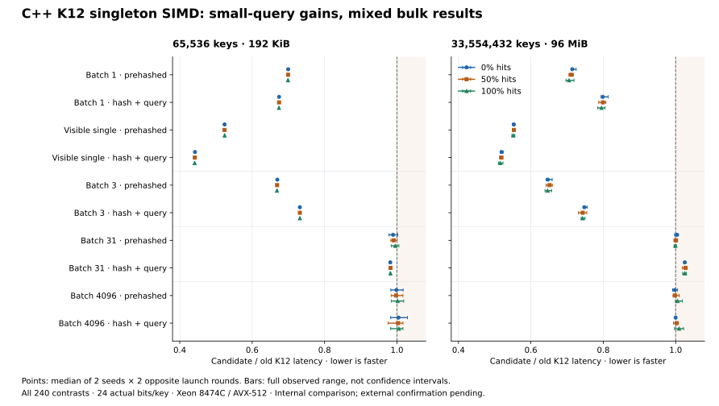
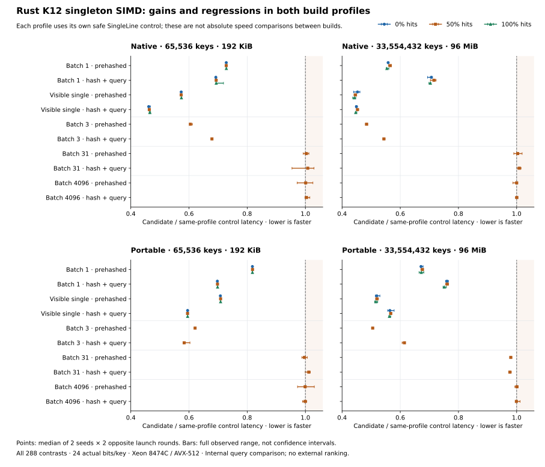

# Fastest Bloom Filter

Native **C++17 and Rust** Bloom filters with **AVX-512 / AVX2**, parallel construction,
parallel membership queries, and an atomic FastPattern type for concurrent readers/writers.
Four native layouts cover different throughput/accuracy tradeoffs: **FastPattern**,
**FourSector**, **Split64**, and **ByteSplit**. Each keeps a key's probes within one cache line.
An optional **Split64Range** type also supports explicit byte budgets between powers of two.
Optional **FourSectorRange12** is available in both languages for the measured strict-FPR bulk-query use case.
The aim is to improve throughput while making the memory and false-positive tradeoffs visible.
The project name is an ambition, not a claim that one implementation wins every workload.

[Build](#build) · [Rust API](#native-rust) · [Multithreading](#multithreading) ·
[Reproduce benchmarks](#run-a-reproducible-comparison) · [External evidence](#modern-external-comparison)

## Modern external comparison

Comparisons constrain **actual bitmap bytes and measured false-positive rate**.
Reports distinguish hashing, public API shape, construction and thread startup.
Pinned baselines include FastFilter, Boost.Bloom1.92, RocksDB FastLocalBloom,
PageBloomFilter, fastbloom, Bloomsday, SBBF and BlowChoc. The
[988-row C++ screen](experiments/2026-10-29-exact-budget-range/screen/OBSERVATIONS.md)
covers 68 external configurations at 12–32 actual bits/key. **No layout wins every workload.**

| Workload | Measured result | Scope and remaining limitation |
|---|---|---|
| [C++ single-key queries](docs/byte-confirmation-2026-10-29.md) | Split64 gains **1.10–1.20×** throughput including hashing in the 0.1% FPR band. | FastFilter wins the strict 0.01% and large-filter 1% bands. |
| [C++ large batches](docs/modern-confirmation-2026-10-28.md) | Eligible native leaders gain **1.10–1.73×** against the fastest eligible external. | 65K/32M keys, 50% hits, batch4096, 16/32-bpk targets; the winning layout varies. |
| [C++ K12 strict-accuracy batches](experiments/2026-10-29-four-sector-range12-strict24-analysis/REPORT.md) | K12 gains **1.09–1.83×** across all 24 primary views. | Three fresh seeds, 65K/32M keys, batches31/4096, 24-bpk/0.01% ceiling; excludes singleton, build and multithreading. |
| [C++ K12 eight-core queries](experiments/2026-10-29-native-k12-parallel-analysis/INTERPRETATION.md) | Wins **24/24** strict24-bpk/0.01% views; large hash+query gains **1.07–1.10×** over Boost24 including thread startup/join. | Three seen seeds, batch4096; wider K12 results retain **75 external losses**, and all equal-byte build comparisons lose to Range. |
| [Rust Range24 queries](experiments/2026-10-29-split64-range-rust-strict24-analysis/REPORT.md) | Gains **2.04–6.09×** including hashing against the fixed external K7 leader. | Two fresh seeds, 65K/32M keys, batches1/31/4096, 24-bpk/0.01% ceiling; K7 was selected by the complete public-probe training screen. |

**Choose by workload.** The [336-row Rust public-probe comparison](experiments/2026-10-29-rust-fastbloom-fixed-probes-performance-analysis/report/INTERPRETATION.md)
strengthens external leaders in 48/216 query views, by up to **1.97×**.
Range's intermediate capacity helps under some byte ceilings, while production
Split64 wins most equal-allocation comparisons in that screen. Rust also retains
Bloomsday singleton losses. The [original and modern raw-u32 comparison](experiments/2026-10-29-vldb-raw32-analysis/RESULTS.md)
retains **29 modern-library losses**, including both large strict bulk comparisons
against Boost24. API and compiler context can change the ranking.

K12 is an optional bulk-query choice in both native libraries. Its
[Rust confirmation](experiments/2026-10-29-four-sector-range12-rust-analysis/REPORT.md)
retains **324 wins and 396 losses** across 720 named pairs; Range wins every
singleton, visible-single and construction comparison. The subsequently integrated
[safe single-line rewrite](experiments/2026-10-29-rust-k12-single-line-analysis/INTERPRETATION.md)
improves K12 visible-single throughput **1.19–1.46×** against its old kernel,
but Range still wins every singleton and build comparison. Native packaging has
[correctness and assembly validation](experiments/2026-10-29-native-rust-k12-integration-plan/proof-final/REPORT.md),
not a new performance claim.

**Parallelism has a size cost.** The [native C++/Rust scaling study](experiments/2026-10-29-split64-range-native-scaling-analysis/report-final/REPORT.md)
measures **2.18–2.61×** allocation+build and **6.83–7.81×** whole-array query
speedups at 32M keys with eight cores against each configuration's serial control.
All ten 65K-key build configurations regress. The
[small-build policy experiment](experiments/2026-10-29-native-build-policy-controls-analysis/DECISION.md)
has not changed default worker selection; its unchanged-code controls leave
31/36 two-seed classifications unresolved under the preset ±3% stability band.

A [C++ single-key SIMD experiment](experiments/2026-10-29-k12-singleton-vector-analysis/INTERPRETATION.md)
improves visible single-key throughput including hashing **1.91–2.27×** against
old K12. All 144 batch1/3 contrasts improve across two seeds and opposite launch
rounds, but large batch31 hash+query regresses **1.8–3.0%**, and batch4096 is mixed.
The completed [616-row external comparison](experiments/2026-10-29-k12-singleton-external-analysis/INTERPRETATION.md)
retains **20 wins, 204 losses and 64 unavailable comparisons** for the candidate
against eligible external single-key leaders. The same counts hold against the
fastest eligible rival in each seed/round. The combined native leaders retain
**193 wins and 63 losses**, with 32 unavailable comparisons; these nested views
are descriptive counts, not independent win rates. The candidate stays experimental.
The [Rust SIMD comparison](experiments/2026-10-29-rust-k12-singleton-internal-analysis/INTERPRETATION.md)
also improves all 224 batch1/3 contrasts against its safe SingleLine control.
Visible single-key throughput including hashing improves **2.14–2.24×** in native
builds and **1.68–1.80×** in portable builds, each against its own control.
Native large batch31 hash+query regresses **0.25–1.51%**; batch4096 is mixed.
The candidate remains experimental, with no external leadership claim.
Portable builds retain a per-key call that native builds inline.

<details>
<summary>See gains and regressions across every query contract</summary>



Each point summarizes two seeds and two opposite launch rounds; bars show the
full observed range, not confidence intervals. The figure includes all 240
contrasts from the [complete report](experiments/2026-10-29-k12-singleton-vector-analysis/INTERPRETATION.md).
Regenerate it with `python3 scripts/plot_k12_singleton.py` (requires matplotlib).

</details>

<details>
<summary>See Rust gains and regressions in both build profiles</summary>



All 288 contrasts are shown. Each build is compared with its own safe SingleLine
control; the panels do not compare absolute native and portable throughput.
Bars show the full two-seed/two-round range, not confidence intervals.
Regenerate with `python3 scripts/plot_rust_k12_singleton.py` (requires matplotlib).

</details>

Experiments retain regressions. For example, [conditional C++ insertion](experiments/2026-10-29-k12-prefetch-line-or-analysis/DECISION.md)
helps the 96 MiB K12 filter but causes stable 3 MiB insertion losses, so it is not
integrated. [Rust inline hints](experiments/2026-10-29-rust-k12-singleton-inline-analysis/REPORT.md)
also retain batch regressions. These results and all other comparisons are in the
[evidence index](docs/benchmark-evidence-index.md).

The [complete 486-row Poppy comparison](experiments/2026-10-29-poppy-public-speed-analysis/INTERPRETATION.md)
adds 47 public mappings with cache bytes charged. Poppy wins none of the 384
comparable query or build views against retained external leaders. The native
composite still loses **73 query and 42 build views**, all to Bloomsday.
These are nested views from one seen seed and two launch rounds, using the
frozen prepared-u64/byte8 contract; they do not measure direct raw Poppy APIs.
A separate [fastbloom-rs raw-byte caller](experiments/2026-10-29-fastbloom-rs-raw8-caller/proof-final/REPORT.md)
passes normal/ASan checks for all 24 public probe counts and 21 retained controls.
Its hashes stay inside the clock, and required build scratch is included in
allocation+build. Its fixed 786-row comparison is running; results will be
reported after the complete raw archive is validated.

See the [baseline survey](docs/external-survey-2026-10-28.md),
[benchmark contract](#what-the-numbers-mean), and [bbtree lessons](docs/bbtree-lessons.md).
Quality gates use pointwise 95% Wilson upper bounds, not hard guarantees.
Complete reports retain timings, allocations, quality failures and compiler/API
boundaries needed to interpret each lead.

## Native layouts

| Layout | C++ header/type | Rust type | Observed FPR at 16 actual bits/key |
| --- | --- | --- | --- |
| FastPattern | `fast_pattern_BF.h` / `FastPatternBF` | `FastPatternBloomFilter` | About 0.20% |
| FourSector | `four_sector_bloom.h` / `FourSectorBloomFilter` | `FourSectorBloomFilter` | About 0.098% |
| Split64 | `split64_bloom.h` / `Split64BloomFilter` | `Split64BloomFilter` | About 0.091% |
| ByteSplit | `byte_split_bloom.h` / `ByteSplitBloomFilter` | `ByteSplitBloomFilter` | About 0.55% |

These FPRs are measured on uniform hashes, not hard guarantees for arbitrary inputs.
FourSector sets two bits in each of four 32-bit sectors; Split64 sets one in each
of eight 64-bit sectors. Both have native scalar, AVX2 and AVX-512 query paths,
with matching C++/Rust bitmaps, exclusive parallel construction and parallel reads.
Rust detects CPU support at runtime; C++ selects its backend at compilation.
The `disable-avx512` Rust feature disables AVX-512 in the first three layouts.
ByteSplit uses 128-bit SIMD (SSSE3/SSE4.1 in C++, runtime AVX2-gated in Rust),
with a scalar fallback. It adapts FastFilter's Fixed16 mask with direct addressing;
four 16-byte buckets share each aligned cache line. It also supports exclusive
parallel construction and parallel immutable queries, with matching C++/Rust bitmaps.

The four original types' bits/key constructors preserve the repository's **strict next
power-of-two** allocation rule: for a power-of-two key count, requesting 8 yields
16 actual bits/key. Check `SizeInBytes()` / `size_in_bytes()` for real allocation.
All layouts accept prehashed 64-bit keys and support incremental insertion.

**Split64RangeBloomFilter** is available in both native libraries when an
intermediate capacity such as24 bits/key is useful. Its byte-budget constructor
rounds down to complete64-byte lines, within128 bytes through256MiB. Its
`n, bits_per_key` constructor uses an at-most budget, unlike the original types.
The mapping differs even at equal allocation; it is not a serialized substitute
for Split64. See the [C++/Rust API guide](docs/range-capacity.md) and
[integration validation](experiments/2026-10-29-range-production-integration/VALIDATION.md).

Range supports exclusive parallel construction and immutable parallel queries.
Its capacity benefit is confirmed above, while equal-allocation speed losses
remain documented. Large builds benefit from parallelism; small builds still
expose overhead. The bounded build-policy experiment has not changed defaults.

**FourSectorRange12BloomFilter** is also available in C++ and Rust with the same
byte-budget range. It sets 12 bits across four sectors and partitions parallel
construction by the actual physical cache line. C++ provides
`ParallelFourSectorRange12BloomFilter`; Rust exposes parallel methods on the
filter itself. See the [C++/Rust API guide](docs/four-sector-range12.md),
[C++ validation](experiments/2026-10-29-native-k12-cpp/RESULTS.md), and
[Rust validation](experiments/2026-10-29-native-rust-k12-integration-plan/proof-final/REPORT.md).
Backend, sanitizer and non-divisible three/seven-worker checks pass. The
[C++ eight-core comparison](experiments/2026-10-29-native-k12-parallel-analysis/INTERPRETATION.md)
supports strict24 query use, while construction loses to Range and small builds
slow down with eight threads. Rust K12's external performance is still being
investigated; the SIMD study above is an internal query comparison.

## Historical comparison and FastPattern scaling


Measured on **Intel Xeon Platinum 8474C**, Clang 23 / Rust 1.92, AVX-512, with
three seeds. Ratios below are medians of per-case speedups, not best repetitions.

| Workload | Native C++ | Native Rust | Reference |
| --- | --- | --- | --- |
| Single-thread queries, 16 actual bits/key, 8 KiB–64 MiB | **1.10–1.49×** | **1.09–1.35×** | Faster original C++ sectorized filter at equal bytes |
| 8-core build, 64 MiB bitmap | **2.31×** | **2.76×** | Same-language FastPattern serial |
| 8-core queries, 64 MiB bitmap | **6.95×** | **6.98×** | Same-language FastPattern serial |
| 32-core queries, 128 MiB bitmap | **14.40×** | **13.06×** | Same-language FastPattern serial |

Single-thread queries use batch 4096 and hit rates 0/50/100%; scaling uses 50% hits.
Hashing is excluded here; the full report also measures hash+query. Build scaling
includes partitioning, scratch allocation, and thread startup. At 16 actual bits/key,
pooled all-miss FPR is **0.2020%**, versus **0.2152%** for the original sectorized layout.

**Tradeoffs remain:** small-filter insertion can be slower, small/irregular query
batches do not always improve, and Rust's AVX2 path does not beat its original-layout
baseline in every case. Other designs can be faster at higher FPR or more accurate
at the same space. The optional `fastbloom 0.17.0` comparison explicitly reports
its lower FPR alongside timing; it is not an equal-accuracy speed ranking.

See the [full measured report](docs/results-2026-10-28.md), [raw data and provenance](results/README.md),
and [external baseline adapter](benchmarks/rust-external/README.md). The report includes
all three space budgets, AVX2 results, atomic overhead, 1–32 core scaling, and
before/after experiments for false sharing and the AVX2 kernels.

## Build

```bash
cmake -S . -B build/native -DCMAKE_CXX_COMPILER=clang++ -DBF_NATIVE=ON
cmake --build build/native -j
ctest --test-dir build/native --output-on-failure
```

`BF_NATIVE=ON` gives **all implementations** the same host instruction set. The resulting
binary is specific to the build CPU. For an AVX2-only build, omit `BF_NATIVE`; for AVX-512,
use `-DUSE_AVX512=ON`. These cache options now respect command-line values.
The comparison targets x86 with AVX2 or newer. `compare_benchmark` measures one
thread; `parallel_benchmark` measures scaling across cores.

## Native Rust

The Rust library has no C/C++ dependency or FFI, and no third-party dependencies.
It detects AVX-512 / AVX2 once at construction and uses a portable scalar path
when neither is available.
Rust 1.89 or later is required for the stable AVX-512 intrinsics.
To test or deploy the AVX2 path on an AVX-512 host, use the `disable-avx512`
Cargo feature and a separate target directory:

```bash
CARGO_TARGET_DIR=build/rust-avx2 RUSTFLAGS="-C target-cpu=x86-64-v3" \
  cargo build --release --manifest-path rust/Cargo.toml --features disable-avx512
python3 scripts/check_cross_language.py --cpp build/gcc-avx2/compare_benchmark \
  --rust build/rust-avx2/release/compare_benchmark
```

The `x86-64-v3` build targets AVX2-capable CPUs. A default portable Rust build
continues to choose the supported backend at runtime.

```bash
cargo test --manifest-path rust/Cargo.toml
RUSTFLAGS="-C target-cpu=native" cargo build --release --manifest-path rust/Cargo.toml
python3 scripts/check_cross_language.py
```

```rust
use fastest_bloom_filter::{hash64, FastPatternBloomFilter};

let mut filter = FastPatternBloomFilter::new(1000, 16).unwrap();
let hashes = [hash64(123), hash64(456)];
filter.insert_hashes(&hashes);
let mut present = [0; 2];
filter.lookup_hashes(&hashes, &mut present);
assert_eq!(present, [1, 1]);
```

The equivalent C++ type is `bloom_filters::FastPatternBF` in
[`include/fast_pattern_BF.h`](include/fast_pattern_BF.h), with `Insert`, `Lookup`,
and `SizeInBytes` methods. The C++ implementation selects SIMD at compile time;
it has an AVX2 path and a scalar fallback when compiled without SIMD. Performance claims
must name the enabled instruction set.

## Multithreading

Both languages support parallel construction, parallel immutable queries, and a
separate atomic filter for overlapping writers/readers.

For FourSector, Split64 and ByteSplit, C++ provides `ParallelFourSectorBloomFilter`,
`ParallelSplit64BloomFilter` and `ParallelByteSplitBloomFilter` in `parallel_layout_bloom.h`, with the same
`InsertParallel` / `LookupParallel` interface shown below. Their Rust types expose
`insert_hashes_parallel` / `lookup_hashes_parallel` directly. Each builder partitions
by its layout's actual cache-line index; it does not replicate the bitmap per worker.
`ParallelSplit64RangeBloomFilter` is provided separately in
`parallel_split64_range_bloom.h`; Rust Range exposes the same parallel methods.
Optional C++ K12 uses `ParallelFourSectorRange12BloomFilter` in
`parallel_four_sector_range12_bloom.h`; Rust K12 exposes the same parallel
methods as Range. Both partition by K12's actual physical-line mapping.
The overlapping reader/writer atomic type is currently FastPattern only.

The new-layout [1–8 core measurements](docs/layout-parallel-2026-10-28.md) cover
16M/32M keys at 16 actual bits/key. Eight-core query speedups are **6.97–7.41× in C++**
and **7.07–7.60× in Rust** against each layout's own serial version. Build speedups
are **2.27–3.01× / 2.30–3.30×**, including partitioning, scratch and thread startup.
These are scaling results, separately scoped from the external single-thread comparison.

| Use case | C++ | Rust |
| --- | --- | --- |
| Exclusive parallel build, then read-only queries | `ParallelFastPatternBF` in `parallel_bloom.h` | `FastPatternBloomFilter::insert_hashes_parallel` |
| Parallel read-only batch | `LookupParallel` | `lookup_hashes_parallel` |
| Concurrent inserts and queries | `AtomicFastPatternBF` | `AtomicFastPatternBloomFilter` |

```cpp
#include "parallel_bloom.h" // compile/link with -pthread
bloom_filters::ParallelFastPatternBF filter(num_keys, 16);
filter.InsertParallel(num_keys, hashes, 8);
filter.LookupParallel(num_queries, query_hashes, out, 8);
```

```rust
let mut filter = FastPatternBloomFilter::new(hashes.len(), 16).unwrap();
filter.insert_hashes_parallel(&hashes, 8);
filter.lookup_hashes_parallel(&query_hashes, &mut out, 8);
```

The exclusive builder aligns histogram rows to 64 bytes to avoid false sharing,
partitions hashes by complete cache lines, then gives each
worker its own bitmap region. It uses approximately **8 bytes per input hash** of
temporary storage plus small worker metadata, rather than one bitmap copy per thread.
`BuildScratchBytes` / `build_scratch_bytes` expose partitioning data scratch bytes;
allocator metadata, thread launch bookkeeping, and OS thread stacks are excluded.
Partitioning and thread creation are
included in the scaling benchmark. Small batches fall back to one worker; requested
workers are capped by input size, bitmap partitions, and a limit of 1024. Zero means
automatic selection (`hardware_concurrency` in C++, `available_parallelism` in Rust).
The caller must grant exclusive access during non-atomic construction.

The atomic type supports shared concurrent insertion and lookup, with atomic ORs
and atomic reads for every bitmap access. A query overlapping an unfinished insert
may miss that key. After joining or otherwise synchronizing completed writers,
there are no false negatives. These relaxed atomics **do not publish other data**.
The atomic type pays for stronger concurrency support and is benchmarked separately.
No API supports deletion or concurrent resizing.

```bash
python3 scripts/run_parallel.py --output-dir results/scaling-cpp \
  --cpus 2,4,6,8,10,12,14,16 --threads 1,2,4,8
python3 scripts/run_parallel.py --output-dir results/scaling-rust \
  --executable rust/target/release/parallel_benchmark \
  --cpus 2,4,6,8,10,12,14,16 --threads 1,2,4,8
python3 scripts/check_parallel_parity.py
# The new layouts use the same scaling runner, grouped by layout for parity:
python3 scripts/run_parallel.py --output-dir results/layout-scaling \
  --cpus 2,4,6,8,10,12,14,16 --threads 1,2,4,8 --filters FourSector,Split64
```

Choose physical cores on one NUMA socket for an initial scaling study. The runner
pins each process to the first T listed CPUs, records topology, and runs cases
serially. Scaling is relative to each selected layout's own serial
path. This measures wall-clock batch throughput, including thread startup, rather
than per-operation latency or a warmed persistent thread pool. Atomic timing rows
measure parallel build followed by read-only queries; overlapping reader/writer
correctness is tested separately.

## Run a reproducible comparison

```bash
python3 scripts/run_comparison.py \
  --executable build/native/compare_benchmark \
  --cpu 2 --output-dir results/my-run \
  --key-powers 12,16,20,24,25 --bits-per-key 16 \
  --hits 0,50,100 --batches 4096 --seeds 42,43,44
```

Choose a CPU allowed by your environment. The runner executes serially on that CPU,
shuffles implementation order per seed, and saves CSV rows, exact commands, compiler
flags, CPU information, executable hash, revision, and tracked source changes.
Use a new output directory for each run. Run from a committed checkout for reproducibility.

To run the same workload in Rust, use
`--executable rust/target/release/compare_benchmark` with a different output directory.
The two binaries share SplitMix64/Fisher–Yates workload generation and the same
64-bit hash finalizer. `check_cross_language.py` compares space, FPR counts, and
full-output checksums across both implementations.

A single case is also available:

```bash
# key power, requested bits/key, hit %, query power, batch size, repetitions, seed
./build/native/compare_benchmark 16 16 0 22 4096 5 42
# Optional arguments 8–10: exact filter names, insertion batch, calibration power.
# Example: FastPatternBF,Split64BloomFilter 65536 24
```

Optional layouts are available in both languages through
`--filters Split64RangeBloomFilter,FourSectorRange12BloomFilter`. The parallel
runner uses family names: `--filters Split64Range,FourSectorRange12`.
See the [Range examples](docs/range-capacity.md#ordinary-benchmark-selection)
and [K12 examples](docs/four-sector-range12.md#ordinary-benchmark-selection).

Try `--batches 1,31,4096` to distinguish single-key calls, irregular tails, and large
batches. Large filters should be tested beyond the machine's last-level cache as well
as in cache. The default queries stream through 2^22 entries; filters and inputs are
warmed before timed queries. This measures sustained throughput, not cold-start latency.
Unknown or duplicate filter names are rejected. The runner also checks that every
requested implementation and workload appears in the returned rows. The first
timed prehashed and hash+query outputs are checked against the complete warm-up
checksum outside the timers.

### What the numbers mean

| Metric | What is measured |
| --- | --- |
| `filter_bytes`, `actual_bpk` | Actual filter payload allocation, not the requested budget |
| `insert_ns` | Median insertion time per key into a fresh, allocated filter; hashing excluded |
| `allocate_insert_ns` | Median constructor + insertion time per key; hashing excluded |
| `lookup_ns` | Median query time per key with precomputed hashes |
| `hash_lookup_ns` | Median hashing + query time per key, using batch-sized scratch storage |
| `lookup_min_ns`, `lookup_max_ns` | Spread across repetitions, in addition to the median |
| `absent_queries`, `false_positives`, `fpr` | False positives divided by genuinely absent queries; `nan` when there are none |
| `hash_bits`, `present_queries` | Hash width and actual number of present queries |
| `result_checksum` | FNV-1a over the entire warmed output, for cross-language validation |

Pure-query and hash-plus-query paths call the same non-inlined query kernel to
avoid differences from call-site-specific code generation. Hash buffers are aligned
to 4096 bytes; output starts 64 bytes into an aligned allocation, avoiding identical
page offsets for the 32-bit input/output streams. Function-call cost is included,
so batch size 1 includes that overhead. Filter payloads retain their own alignment.

Each implementation receives the same shuffled raw keys and hit/miss workload. Present
and absent raw-key sets are disjoint. Hashing uses the existing `HashVector` overload for
that implementation: **32-bit and 64-bit hash costs differ**, so both pure query and
hash-plus-query timings are reported. Timing uses `steady_clock` and the actual number
of operations. Every timed output is consumed outside the timed region. Every inserted
key is checked for false negatives; a failure terminates the benchmark.

**Compare speed together with space and FPR.** Legacy constructors round upward, even
when a requested size is already a power of two. Some also cap their allocations:
32-bit register filters at 512 KiB, and `NewCacheSectorizedBF32Bit` at 64 MiB. A tiny,
saturated filter must not win a large-filter comparison by returning mostly positives.
The legacy mask-table implementations additionally share 132- or 136-byte static
mask tables. FastPattern has two shared 128-byte dictionaries (one active per filter).
These tables, object size, and allocator overhead are excluded from `filter_bytes`.

Equal bytes do not imply equal FPR. Use a bits/key sweep to find comparable error-rate
budgets, and retain negative-query sample counts: a zero observed false-positive count
is not proof of zero FPR. Do not rank incomparable rows as an overall winner. Results
also depend on CPU, compiler, cache size, batch size, and hit rate. Repeat across seeds
and machines before making broader claims.

The original `main_benchmark` and `scripts/run_benchmarks.py` remain for historical
reproduction. Use `compare_benchmark` for new comparisons; the legacy program includes
hashing in its lookup timing and has weaker timing and validation controls.

## API

Inputs are **already hashed** integers. Output contains one `0` or `1` per input, in the
same order; a positive means “possibly present.” These filters are append-only and require exclusive writes unless using the separate atomic type.

```cpp
#include <vector>
#include "fast_pattern_BF.h"

int main() {
    bloom_filters::FastPatternBF filter(1000, 16);
    uint64_t raw[] = {123, 456};
    uint64_t hashes[2];
    bloom_filters::HashVector(2, raw, hashes);
    filter.Insert(2, hashes);
    uint32_t present[2];
    filter.Lookup(2, hashes, present); // both entries are 1
    return !(present[0] && present[1]);
}
```

`SizeInBytes()` exposes actual payload bytes. Most implementations take 64-bit hashes;
`RegisterBlockedBF32Bit` and its masks variant take 32-bit hashes. The benchmark rejects
sizes that would overflow legacy constructors. The historical sectorized implementations
use type-punned loads, so the supplied build applies `-fno-strict-aliasing` uniformly.

## Correctness checks

```bash
cmake -S . -B build/sanitize -DCMAKE_CXX_COMPILER=clang++ \
  -DBF_NATIVE=ON -DBF_SANITIZERS=ON -DCMAKE_BUILD_TYPE=Debug
cmake --build build/sanitize -j
ctest --test-dir build/sanitize --output-on-failure
```

Tests cover concurrent readers/writers, non-power-of-two worker counts, colliding
cache-line inserts, empty inputs, short and odd batches, unaligned inputs, repeated inserts,
output bounds, SIMD/scalar agreement, batch/single-query agreement, and no false negatives. The comparison
also fails on correctness errors before reporting timing results. Sanitized timings
are for debugging only, never performance comparisons.

[`scripts/ci-reference.yml`](scripts/ci-reference.yml) contains a CI template; it is
not enabled as a GitHub workflow. The measured report records local validation.

## Optimization design

FastPattern keeps both sector reads in one 64-byte cache line. Independent hash
fields select the first word, its partner, and two rotated masks. AVX-512 lookup
handles 16 keys at once; mask generation uses two register-resident tables and
vector rotates. The AVX2 path processes eight queries, gathers its tiny mask
dictionary from L1, and implements rotates with variable shifts. Large filters
prefetch future independent queries. An eight-key AVX-512 tail handles short
batches before the remaining scalar tail. Inserts compute
masks in batches but apply OR updates sequentially, preserving colliding keys.

The filter selects three bits per sector below 12 actual bits/key, and four otherwise.
This choice is fixed at construction; overfilling increases FPR as with other Bloom
filters. It is not a target-FPR sizing API. Tables are deterministically generated by
[`scripts/generate_patterns.py`](scripts/generate_patterns.py), balancing repeated
pairs and triples under cyclic rotation. The design requires uniformly hashed input.

Earlier interleaved, direct split-block, and smaller-dictionary prototypes live under
[`experiments/2026-10-28-prototypes`](experiments/2026-10-28-prototypes). Enable them
with `-DBF_EXPERIMENTS=ON` for ablation; they are not automatically better designs.
The benchmark reports losses as well as improvements. Every published measurement
records its source revision, build configuration, and raw counts.

## Background

Inspired by Harald Lang, Thomas Neumann, Alfons Kemper, and Peter Boncz,
[Performance-optimal filtering: Bloom overtakes Cuckoo at high throughput](https://doi.org/10.14778/3303753.3303757)
(VLDB 2019). The optimization experiments also draw on
[bbtree's cost-model approach](https://blog.xiangpeng.systems/posts/bbtree/): reduce
cache misses, overlap independent memory accesses, and reduce instructions on hot data.
See [how those ideas map to these filters](docs/bbtree-lessons.md), including
cache-line ownership and the measured limits of instruction-level changes.

[MIT license](LICENSE); ByteSplit's derived implementation is covered by the
[Apache-2.0 component notice](third_party/FastFilter/NOTICE) and retained license.
