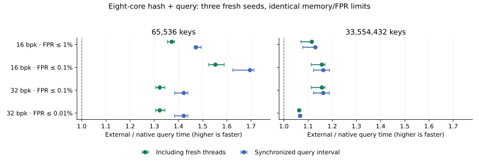

# External comparison on eight physical cores

The native C++ portfolio leads the eligible external shortlist in every reported query cell, on all three fresh seeds. Including common hashing, fresh thread creation, pinning and joining, the fixed-pair speedups range from **1.060–1.589×** across paired seeds. This result covers batch 4096, 50% hits, 65,536/33,554,432 inserted keys, and eight physical cores of one Xeon Platinum 8474C. It does not establish a universal fastest filter or an external multithreaded Rust result.

## Hashing plus query, including fresh threads

Each row fixes the native and external configurations using the median of three seed medians. Latencies are elapsed nanoseconds per query across all eight cores, not per-key dependent latency. Speedup is external/native; the range compares the same pair on each seed. The plot's center is the median paired-seed speedup.

| Keys | Memory cap | FPR ceiling | Native leader | ns/query | External leader | ns/query | Speedup | Paired range |
| ---: | ---: | ---: | --- | ---: | --- | ---: | ---: | ---: |
| 65,536 | 16 bits/key | 1.00% | FastPattern (16 bpk) | 0.205 | FastFilter SIMD SingleV1 | 0.283 | 1.380× | 1.354–1.384× |
| 65,536 | 16 bits/key | 0.10% | FourSector (16 bpk) | 0.254 | FastFilter Fixed64 | 0.395 | 1.553× | 1.525–1.589× |
| 65,536 | 32 bits/key | 0.10% | FastPattern (32 bpk) | 0.212 | FastFilter SIMD | 0.281 | 1.323× | 1.306–1.344× |
| 65,536 | 32 bits/key | 0.01% | FastPattern (32 bpk) | 0.212 | FastFilter SIMD | 0.281 | 1.323× | 1.306–1.344× |
| 33,554,432 | 16 bits/key | 1.00% | FastPattern (16 bpk) | 0.596 | Boost Multi32K8 | 0.653 | 1.096× | 1.071–1.118× |
| 33,554,432 | 16 bits/key | 0.10% | FourSector (16 bpk) | 0.598 | Boost Multi64K8 | 0.686 | 1.147× | 1.114–1.170× |
| 33,554,432 | 32 bits/key | 0.10% | FourSector (16 bpk) | 0.598 | Boost Multi64K8 | 0.686 | 1.147× | 1.114–1.170× |
| 33,554,432 | 32 bits/key | 0.01% | FastPattern (32 bpk) | 0.785 | Boost Multi32K8 | 0.835 | 1.064× | 1.060–1.064× |

The conservative comparison against the fastest pooled-quality-eligible external chosen separately for each seed also stays above 1.060×. All four query metrics are retained: prehashed and hash-plus-query, each with a synchronized kernel interval and a fresh-thread end-to-end interval. The kernel interval includes worker wakeup and completion synchronization. End-to-end additionally includes launch, affinity setup, joining and destruction; preallocated input/output/hash scratch is outside both timers and its bytes are reported.

## Contract and eligibility

The 56-configuration executable ran the prespecified 23-configuration shortlist: four native layouts plus pinned FastFilter, PageBloomFilter, Boost.Bloom and RocksDB core configurations. Every filter uses one shared immutable bitmap, the same eight physical cores, identical queries and dense outputs, and the same global query-batch boundaries. The caller is worker zero; seven other threads are created. Construction remains serial and separately measured. This does not compare concurrent insertion algorithms or eight bitmap replicas.

All 12 workloads / 276 rows completed with five repetitions and unchanged source and binary hashes. Seeds 19867, 45631 and 93187 contribute 50,331,648 independent negative probes per exact filter/allocation configuration. Raw negative intervals are disjoint. Repeated timing controls do not multiply the calibration sample size. Eligibility uses exact payload allocation with no slack and the **upper endpoint of a two-sided 95% Wilson interval** (z=1.959964), a stricter bound than the earlier single-thread report's one-sided 95% bound. These are pointwise quality intervals, not simultaneous guarantees after winner selection. Both measured allocations can compete below a cap; a 32-bpk cap can select a 16-bpk filter. No measured configuration qualifies for 0.01% FPR under the 16-bpk cap.

All selected pairs also pass their target on every seed separately. Qualification near a boundary remains seed-sensitive: small FastPattern at 32 bpk failed 0.01% in the earlier seed-42 screen, but passes all three new seeds (pooled upper 0.009436%). Large FourSector at 16 bpk similarly changes from an earlier screen failure to passing 0.1% on every fresh seed (pooled upper 0.098575%). Both earlier failures are preserved; these measurements are not input-independent FPR promises.

## Remaining losses and validation

Choosing a portfolio leader does not make every native layout faster. Large ByteSplit at 16 bpk loses to Boost Multi32K8 in the gated hash-plus-query metric (0.935–0.954× paired speedups); small Split64 loses in the loose 1% tier (0.802–0.820×). Individual-family rankings retain these losses. Single-key and irregular batches require their own comparisons.

The harness validates complete dense output and checksums outside every timed trial, all inserted keys, disjoint output ownership and global tails. Native, ASan/UBSan and TSan checks cover representative filters, launch failures, worker exceptions, affinity failures and cleanup. Full-registry parity covers all 56 configurations. Eleven confirmation-analysis regression tests pass. The 1/4-core runs remain exploratory; same-row serial controls in this confirmation independently report native scaling. Observed ratios slightly above eight do not prove algorithmic superlinear scaling.

## Reproduce and inspect

The [frozen protocol](../experiments/2026-10-29-external-parallel-query/confirmation8/protocol.json), [complete four-metric report](../experiments/2026-10-29-external-parallel-query/confirmation8/RESULTS.md), [raw CSV](../experiments/2026-10-29-external-parallel-query/confirmation8/results/results.csv), [paired-seed details](../experiments/2026-10-29-external-parallel-query/confirmation8/results/paired-seed-comparison.csv) and [reproduction commands](../experiments/2026-10-29-external-parallel-query/confirmation8/README.md) retain every rival, allocation and timing sample. The measured framework is `b437791b6edf23fe8725f87e62d21d638216861a`; its binary SHA-256 is `f39ddeab1538c812bea663110a4b1eba14eaf29694014533e3e9b08cacd3cbdb`. Regenerate this document and plot with `python3 scripts/summarize_external_parallel.py` (matplotlib required).
