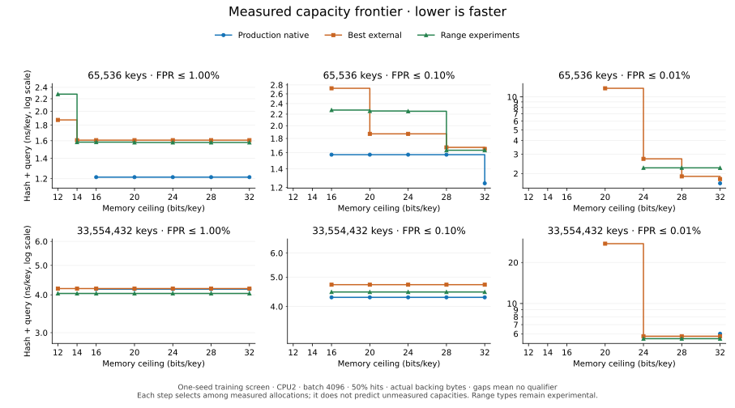

# Supplementary capacity frontier

This descriptive view selects the fastest measured allocation fitting each of the seven memory ceilings, separately for production natives, external implementations and project range experiments. Lower is faster; the vertical axis is logarithmic. A missing point means that group has no measured configuration passing the memory and FPR gates. Steps describe the best available measured allocation, not an interpolation of unmeasured filters.

The visualization was planned after the small-table measurements began. It supplements the prespecified 16/32-bpk rankings in [RESULTS.md](RESULTS.md); it is exploratory training evidence, with pointwise FPR bounds and no simultaneous winner-selection or held-out speed guarantee. [capacity-frontier.json](capacity-frontier.json) retains every selected configuration, its actual bytes, quality bound, timing and source provenance.
