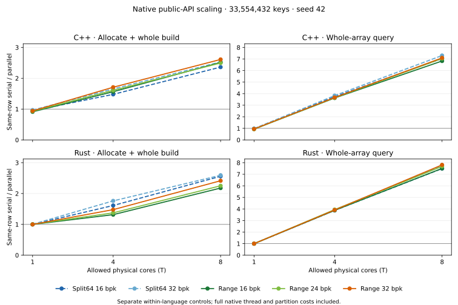

# Native public-API scaling screen

Complete60-row source `0129cbdb116bdf56be1c6ab0ba5a973c495d07c2`; raw archive `dda886e23bb0196b70d93c12c35488d80b5d9891`. This is one seed42 training screen on one host.
C++ and Rust are reported separately. All comparisons retain fresh native thread startup, partition passes and scratch costs. No cross-language leadership claim is made.

The primary ratios divide each row’s own serial median by its parallel median. Separate T1 ratios compare the same public parallel API at T1 and T4/T8; they are supplemental because workload groups execute at different times. Insert-only, allocate+insert and query are separate intervals. Four build repetitions use one balanced Williams cycle; queries alternate AB/BA. Cases and languages have fixed order, and all build trials precede queries.

## Same-row serial/parallel ratios

| Language | Family | Interval | T | Wins | Losses | Ties | Minimum | Median | Maximum |
|---|---|---|---:|---:|---:|---:|---:|---:|---:|
| cpp | Split64 | parallel_allocate_insert | 1 | 2 | 2 | 0 | 0.945 | 1.043 | 1.327 |
| cpp | Split64 | parallel_allocate_insert | 4 | 2 | 2 | 0 | 0.290 | 0.895 | 1.654 |
| cpp | Split64 | parallel_allocate_insert | 8 | 2 | 2 | 0 | 0.175 | 1.272 | 2.529 |
| cpp | Split64 | parallel_insert | 1 | 0 | 4 | 0 | 0.942 | 0.961 | 1.000 |
| cpp | Split64 | parallel_insert | 4 | 2 | 2 | 0 | 0.286 | 0.906 | 1.779 |
| cpp | Split64 | parallel_insert | 8 | 2 | 2 | 0 | 0.164 | 1.364 | 3.008 |
| cpp | Split64 | parallel_lookup | 1 | 0 | 4 | 0 | 0.902 | 0.939 | 0.976 |
| cpp | Split64 | parallel_lookup | 4 | 4 | 0 | 0 | 3.535 | 3.643 | 3.832 |
| cpp | Split64 | parallel_lookup | 8 | 4 | 0 | 0 | 6.261 | 6.804 | 7.298 |
| cpp | Split64Range | parallel_allocate_insert | 1 | 1 | 5 | 0 | 0.715 | 0.922 | 1.180 |
| cpp | Split64Range | parallel_allocate_insert | 4 | 3 | 3 | 0 | 0.334 | 0.954 | 1.709 |
| cpp | Split64Range | parallel_allocate_insert | 8 | 3 | 3 | 0 | 0.133 | 1.341 | 2.609 |
| cpp | Split64Range | parallel_insert | 1 | 1 | 5 | 0 | 0.907 | 0.946 | 1.010 |
| cpp | Split64Range | parallel_insert | 4 | 3 | 3 | 0 | 0.313 | 0.964 | 1.837 |
| cpp | Split64Range | parallel_insert | 8 | 3 | 3 | 0 | 0.114 | 1.451 | 3.125 |
| cpp | Split64Range | parallel_lookup | 1 | 0 | 6 | 0 | 0.932 | 0.946 | 0.947 |
| cpp | Split64Range | parallel_lookup | 4 | 6 | 0 | 0 | 3.625 | 3.669 | 3.694 |
| cpp | Split64Range | parallel_lookup | 8 | 6 | 0 | 0 | 6.089 | 6.746 | 7.094 |
| rust | Split64 | parallel_allocate_insert | 1 | 2 | 2 | 0 | 0.957 | 1.000 | 1.003 |
| rust | Split64 | parallel_allocate_insert | 4 | 2 | 2 | 0 | 0.312 | 0.967 | 1.762 |
| rust | Split64 | parallel_allocate_insert | 8 | 2 | 2 | 0 | 0.217 | 1.413 | 2.593 |
| rust | Split64 | parallel_insert | 1 | 2 | 2 | 0 | 0.997 | 0.999 | 1.004 |
| rust | Split64 | parallel_insert | 4 | 2 | 2 | 0 | 0.295 | 0.991 | 1.900 |
| rust | Split64 | parallel_insert | 8 | 2 | 2 | 0 | 0.188 | 1.601 | 3.027 |
| rust | Split64 | parallel_lookup | 1 | 2 | 2 | 0 | 0.998 | 1.000 | 1.001 |
| rust | Split64 | parallel_lookup | 4 | 4 | 0 | 0 | 3.840 | 3.862 | 3.901 |
| rust | Split64 | parallel_lookup | 8 | 4 | 0 | 0 | 6.954 | 7.241 | 7.774 |
| rust | Split64Range | parallel_allocate_insert | 1 | 1 | 5 | 0 | 0.764 | 0.992 | 1.002 |
| rust | Split64Range | parallel_allocate_insert | 4 | 3 | 3 | 0 | 0.295 | 0.810 | 1.478 |
| rust | Split64Range | parallel_allocate_insert | 8 | 3 | 3 | 0 | 0.223 | 1.225 | 2.415 |
| rust | Split64Range | parallel_insert | 1 | 3 | 3 | 0 | 0.999 | 1.001 | 1.006 |
| rust | Split64Range | parallel_insert | 4 | 3 | 3 | 0 | 0.283 | 0.814 | 1.543 |
| rust | Split64Range | parallel_insert | 8 | 3 | 3 | 0 | 0.204 | 1.334 | 2.826 |
| rust | Split64Range | parallel_lookup | 1 | 1 | 5 | 0 | 0.996 | 0.998 | 1.009 |
| rust | Split64Range | parallel_lookup | 4 | 6 | 0 | 0 | 3.811 | 3.863 | 3.943 |
| rust | Split64Range | parallel_lookup | 8 | 6 | 0 | 0 | 6.838 | 7.255 | 7.813 |

Every ratio and every loss remains in the CSV tables. A ratio above1 means the target is faster. These nested descriptive counts are not independent statistical trials. T1 direct fallbacks are retained, including any measured overhead/noise.

## Large input scaling

The four panels use each point’s own same-row serial control. They do not compare C++ speed with Rust speed. Each curve retains one fixed family/allocation, including all T1/T4/T8 points and any slowdown. The complete smaller input and loss records remain in the CSV tables.

## Memory, quality and scheduler contract

Twenty language/family/geometry records each retain the original2^24 calibration denominator. Repeated T rows are deduplicated, never pooled. Identical C++/Rust semantic outputs do not provide independent negative samples. Wilson95 bounds describe only each tested construction/input stream; quality thresholds are descriptive and do not filter any timing loss from this report.

Range16/32 and Split16/32 have144 equal-byte, same-language metric pairs. Range24 has no exact-byte production Split control in this grid; it is not silently compared as if16 or32 bytes were equal. Existing external benchmark latencies are not imported.

The caller is CPU3 for serial work. Native workers inherit firstT physical cores on node1 and may migrate or colocate inside that set. C++ uses caller+W−1 spawned workers; Rust uses W scoped workers plus a coordinator sharing the sameT core budget, except W1 direct fallback. Individual worker pinning is not claimed.

Insert-only bitmaps are constructed on CPU3 before affinity expansion. Inclusive allocate+build begins after expansion. Both include the full public insertion algorithm but differ in first touch as prespecified. Estimated explicit build scratch excludes allocator metadata, runtime handles/stacks and RSS. All inserted and mixed dense outputs are checked outside timing on every build, and every query trial checks complete output and guards.

Files: timings.csv360 metric records; same_row.csv180 ratios; T1.csv120 same-public-API ratios; equal_bytes.csv144 Range/Split pairs; quality.csv20 unpooled records; groups.csv descriptive summaries; losses.csv all individual regressions. No candidate is promoted by this sidecar.
